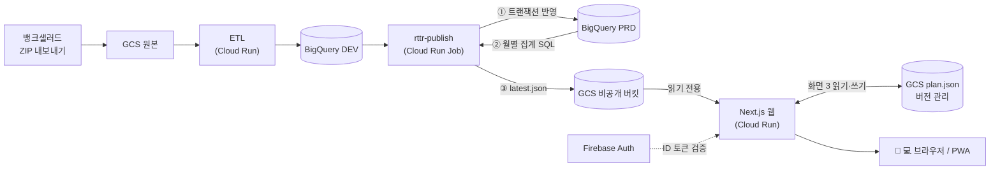

# Road To The Rich

뱅크샐러드 데이터를 BigQuery로 모아 **부부의 자산·가계부·투자·연말정산을 한 화면에서 보는 웹 대시보드**입니다.
Tableau Desktop 대시보드를 대체하려고 만들었고, 모바일·태블릿·PC를 코드 하나로 지원합니다.

**🔗 라이브 데모 — <https://rttr-demo-449610534419.asia-northeast3.run.app/>**
(로그인 없이 공개 · 모든 금액은 합성 데이터)

---

## 화면

| 경로 | 화면 | 주요 내용 |
|---|---|---|
| `/` | **Road To The Rich** | 자산·투자·수입·지출 KPI(전월 대비) + 자산·투자·가계부 추이, 소유자·카테고리 필터 |
| `/year-end` | **Year End Tax Settlement** | 총급여·실수령·세금·카드 지출, 원천징수영수증 7개 항목, 5개년 미니 추이, 카드 소득공제 기준선 |
| `/investment` | **Investment** | 종목별 원금·평가금·수익률 추이, 평가금 변동 분해(추가 투자 vs 시장 손익), 트리맵, 비중×수익률 산점도, 전월·전년 동월 비교 표 |
| `/plan` | **Monthly Plan** | 월 고정 수익·저축·지출 계획표 — 웹에서 직접 편집·저장 (편집자만) |

## 아키텍처



- 웹 서버는 **BigQuery에 직접 붙지 않습니다.** 매월 Job이 미리 집계한 JSON 스냅샷 1개만 읽으므로 조회 비용·지연이 없고, 서버가 뚫려도 노출 범위는 월별 합계뿐입니다.
- 파이프라인과 웹은 **데이터 계약(`web/lib/schema.ts`) 하나**로만 연결됩니다. 합성 데이터도 같은 스키마라서 같은 코드로 데모와 실데이터 두 버전을 운영합니다.

## 설계 포인트

**데이터 품질**
- DEV → PRD 반영은 **BigQuery 멀티 스테이트먼트 트랜잭션 + 멱등 처리** — ETL이 끝까지 성공한 파일만, 이미 반영된 건은 건너뜀
- 수익률은 항상 **합계로 다시 계산** (비율끼리 더하지 않음), 전월 비교는 **두 달 모두 데이터가 있는 사람끼리만**
- 기존 Tableau 대시보드와 **원 단위 대조**로 검증, 차이 원인(환불 이중 계산·결제수단 매핑·레거시 데이터 부호)을 데이터로 규명

**분석형 시각화**
- 평가금 변동을 **추가 투자 / 시장 손익**으로 분해 — 신규 매수·전량 매도·종목 구분 전 레거시 데이터 처리 규칙 포함
- 수백 % 수익률이 섞인 분포는 **로그 눈금**(트리맵 색, 산점도 축)으로 구분

**보안**
- 최소 권한 서비스 계정 분리 — 쓰는 계정(Job)과 읽는 계정(웹)이 다르고, 공개 데모는 **권한 0개** 계정으로 실행
- 서비스 계정 키 파일 없음 (Firebase ID 토큰은 Google 공개키로, GCS는 Cloud Run 기본 인증으로)
- 로그인·허용 목록 통과 전에는 스냅샷을 읽지도 브라우저로 보내지도 않음. 운영 + 실데이터인데 로그인이 꺼져 있으면 **서버가 로딩 자체를 거부**
- iPhone Safari 저장소 분리 대응 — Firebase 로그인 핸들러(`/__/auth`)를 앱 주소 아래로 프록시

**읽기 전용 대시보드에 쓰기 기능 추가 (화면 3)**
- 서버 측 편집자 검사 + 입력값 검증, GCS **generation 기반 낙관적 잠금**(두 기기 동시 수정 보호), 전용 버킷으로 쓰기 권한 분리, 객체 버전 관리로 복구

**비용**
- 서버리스(인스턴스 0까지 축소) + 사전 집계 스냅샷 → 사용량 기준 무료 구간

## 기술 스택

| 영역 | 사용 |
|---|---|
| Web | Next.js 16 (App Router, standalone) · React 19 · TypeScript · Tailwind CSS v4 · Apache ECharts 6 |
| Auth | Firebase Authentication (Google) · firebase-admin |
| Pipeline | Python 3.11 · google-cloud-bigquery / storage |
| Infra | Cloud Run (서비스 + Job) · Cloud Storage · BigQuery — 서울 리전 |

## 로컬에서 실행 (데모)

```bash
cd web
npm install
npm run dev            # http://localhost:3000 — 합성 데이터, 로그인 없음
npm test               # KPI·투자·계획표 규칙 회귀 테스트
npm run typecheck
```

## 폴더 구조

| 경로 | 역할 |
|---|---|
| `pipeline/sql/*.sql` | 집계 쿼리 — 화면 1: asset / investment / ledger, 화면 2: year_end_monthly / year_end_annual, Investment: investment_product |
| `pipeline/export_snapshot.py` | PRD(또는 DEV) → 스냅샷 JSON (로컬 파일 / GCS) |
| `pipeline/publish.py` | Cloud Run Job 본체 — DEV→PRD 반영(트랜잭션) + 스냅샷 |
| `pipeline/generate_demo.py` | 합성 데이터 생성 (실데이터와 같은 스키마) |
| `web/lib/schema.ts` | 📌 데이터 계약 (스냅샷 v3) — 파이프라인과 웹의 유일한 약속 |
| `web/lib/metrics.ts` · `yearEnd.ts` · `invest.ts` · `plan.ts` | 화면별 계산 로직 (+ `*.test.ts` 회귀 테스트) |
| `web/lib/data.ts` · `guard.tsx` · `auth.ts` | 데모/실데이터 모드 전환, 화면 공통 관문(로그인 → 데이터), 토큰 검증 |
| `web/lib/planStore.ts` · `app/api/plan/` | 화면 3 저장소(GCS·로컬 파일) / 저장 API |
| `web/components/` | 화면별 대시보드, KPI 카드, ECharts 차트 |
| `web/data/` | 데모 데이터 (합성) |

## 두 가지 버전

| 버전 | 데이터 | 로그인 | 실행 |
|---|---|---|---|
| 데모 (공개) | `web/data/demo-*.json` (합성) | 없음 | `DATA_MODE=demo` |
| 실데이터 | GCS 비공개 버킷의 스냅샷 | Google + 허용 목록 | `DATA_MODE=private`, `AUTH_ENABLED=true` |

실데이터를 로컬에서 볼 때는 `web/.env.local`(`.env.example` 참고)을 채운 뒤:

```bash
npm run data:real      # 운영 스냅샷 → web/.private/snapshot.json   (BigQuery 직접: npm run data:real -- bq)
npm run dev:real       # http://localhost:3001 — 실데이터 + 로그인
```

> 🔒 `.private/`, `.env*`(견본 제외), `deploy/*.env.yaml`, 스냅샷 JSON은 `.gitignore`·`.dockerignore`·`.gcloudignore`로 Git·배포 이미지에서 제외됩니다.

## 환경변수 (`web/.env.example`)

| 변수 | 설명 |
|---|---|
| `DATA_MODE` | `demo`(기본) / `private` |
| `SNAPSHOT_SOURCE` | private 모드의 스냅샷 위치 — 로컬 파일 경로 또는 `gs://bucket/path.json` |
| `AUTH_ENABLED` | `true`면 Google 로그인 + 허용 목록 검사 |
| `ALLOWED_EMAILS` · `EDITOR_EMAILS` | 접속 허용 계정 / 화면 3 편집 계정 (쉼표 구분) |
| `PLAN_SOURCE` | 화면 3 저장 위치 — 로컬 `.private/plan.json` / 운영 `gs://bucket/app/plan.json` |
| `FIREBASE_*` | Firebase 웹 앱 설정 (공개 식별자). 운영은 `FIREBASE_AUTH_DOMAIN=self` |
| `SNAPSHOT_GCS_URI` · `BQ_PROJECT` | 로컬 도구(`npm run data:real`) 전용 |

## 배포 (Cloud Run)

- **실데이터 (로그인 필수):** [`web/DEPLOY_WEB.md`](web/DEPLOY_WEB.md)
- **월간 반영 Job:** [`pipeline/DEPLOY_PUBLISH_JOB.md`](pipeline/DEPLOY_PUBLISH_JOB.md)
- **공개 데모:** 운영 이미지를 그대로 재사용하고 환경변수만 바꿉니다.

```bash
gcloud run deploy rttr-demo --image <운영 이미지 주소> --region asia-northeast3 \
  --service-account rttr-demo@<프로젝트>.iam.gserviceaccount.com \
  --set-env-vars DATA_MODE=demo,AUTH_ENABLED=false \
  --allow-unauthenticated --min-instances 0 --max-instances 1
```

## KPI 규칙 요약

- 자산·투자: 소유자별 **월 마지막 스냅샷** 기준
- 수입·지출: 거래일 기준, 지출은 취소·환불을 차감한 순액
- 수익률 = (평가금 − 원금) ÷ 원금, **합산 후 재계산**
- 전월·전년 동월 비교는 **같은 사람·같은 종목끼리만**, 비교 달에 없던 종목은 "신규"
- 선택한 달에 가계부가 없으면 0 대신 가장 최근 달을 보여주고 "N월 기준" 배지 표시
- 증감 색: 좋은 방향 파랑 / 나쁜 방향 빨강 + ▲▼ (지출은 감소가 좋은 방향, 원금 증감은 회색)
